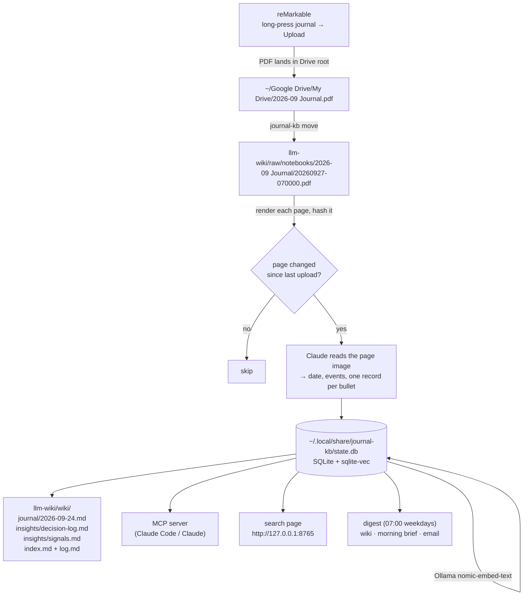

# journal-kb

Turns the bullet journal you write on the reMarkable into:

- structured records (every task, decision, question, note and signal on every page),
- pages in your LLM wiki (`wiki/journal/`, a decision log, a signals page),
- a local vector index you can search from Claude (MCP), a browser page, or the command line,
- a morning digest delivered to the wiki, your morning brief, and/or your email.

The notation it reads is the Key from *The Output Notebook* (https://claude.ai/artifact/GUXSpGgLaUARs1HUa8serM).
If you draw the symbols the same way every time, the pipeline reads them the same way every time.

## Contents

- [How it works](#how-it-works)
- [Status: what has and hasn't been run for real](#status-what-has-and-hasnt-been-run-for-real)
- [Install](#install)
- [Configure](#configure)
- [First run (the M0 spike)](#first-run-the-m0-spike)
- [Daily use](#daily-use)
- [Commands](#commands)
- [Scheduling with launchd](#scheduling-with-launchd)
- [Asking questions](#asking-questions)
- [The digest](#the-digest)
- [What it writes into the wiki](#what-it-writes-into-the-wiki)
- [How a page is read](#how-a-page-is-read)
- [Privacy](#privacy)
- [Tuning](#tuning)
- [Troubleshooting](#troubleshooting)
- [Known limits](#known-limits)
- [Development](#development)

## How it works



Each upload is kept in `raw/notebooks/` as an immutable snapshot. Only pages whose rendered image
changed since the previous upload are sent to Claude, so re-uploading a growing monthly journal every
day costs only the new and edited pages. When you tick a task (×) or migrate it (>) during your
morning migration, that page changes, gets re-read on the next upload, and the task's state updates
everywhere. Paper stays the source of truth.

## Status: what has and hasn't been run for real

| Part | Verified how |
|---|---|
| Drive-root mover, page diffing, SQLite + sqlite-vec index, wiki writers, digest, launchd plists, CLI | 46 unit tests (`uv run pytest`), plus an end-to-end run on a temp wiki |
| Ollama embeddings (`nomic-embed-text`) | End-to-end run against the local Ollama server |
| Search page (`serve`) and MCP server (`mcp`) | Started for real; HTTP search + page image and an MCP `initialize` + `tools/call` over stdio |
| Claude request shape (model, image block, JSON schema) | Request captured locally; the schema is strict JSON with the bullet/state enums |
| **Claude actually reading your handwriting** | **Not run.** There was no API key on this machine. This is the M0 spike below. |
| **Email delivery** | **Not run** against Gmail; the message composition is unit-tested. |
| **Morning brief section** | **Not run**; needs one line added to your morning brief task (see [The digest](#the-digest)). |

## Install

Requirements: macOS, [uv](https://docs.astral.sh/uv/), [Ollama](https://ollama.com), Google Drive for
Desktop syncing `My Drive`, and a Claude API credential.

```bash
cd ~/Desktop/journal-kb
uv sync --locked
ollama pull nomic-embed-text
mkdir -p ~/.config/journal-kb
cp config.example.toml ~/.config/journal-kb/config.toml
```

`--locked` installs exactly what `uv.lock` lists, each file checked against its hash, and fails if the lockfile is out of date. `pyproject.toml` sets `exclude-newer = "2 weeks"`, so `uv lock` and `uv add` never pick a version published in the last 14 days ([uv: dependency cooldowns](https://docs.astral.sh/uv/concepts/resolution/#dependency-cooldowns)).

The command is then available as `uv run journal-kb` from this folder, or directly as
`~/Desktop/journal-kb/.venv/bin/journal-kb` from anywhere.

### Claude credential

The Anthropic SDK looks for, in order: `ANTHROPIC_API_KEY`, `ANTHROPIC_AUTH_TOKEN`, then a profile
created by `ant auth login`. Scheduled jobs (launchd) do not see your shell's environment variables,
so for unattended runs store the key in the macOS keychain and point the config at it:

```bash
security add-generic-password -s journal-kb-anthropic -a journal-kb -w
```

(it prompts for the key), then in `config.toml`:

```toml
[reader]
api_key_keychain_service = "journal-kb-anthropic"
```

## Configure

Everything lives in `~/.config/journal-kb/config.toml`; `config.example.toml` documents every key.
The ones you are most likely to touch:

| Key | Default | Why you'd change it |
|---|---|---|
| `paths.wiki_root` | `~/Google Drive/My Drive/llm-wiki` | Wiki moved |
| `[[notebooks]]` | `* Journal`, `1:1 *`, `Architecture`, `Future Log` | You name notebooks differently. Matching is on the PDF name without `.pdf`. |
| `reader.model` | `claude-sonnet-5` | Try `claude-opus-5` if the spike shows Sonnet misreads your handwriting |
| `digest.outputs` | `["wiki", "morning"]` | Add `"email"` (and set `digest.email.to`) |
| `digest.include_one_on_ones` | `false` | Put 1:1 tasks in the digest. This also writes them into the wiki's digest page. |
| `move.enabled` | `true` | Set `false` if you move uploads into `raw/notebooks/` with your own tool |

Notebook PDFs can sit in `raw/notebooks/` in either layout:

- `raw/notebooks/2026-09 Journal/20260927-070000.pdf`: what `journal-kb move` produces. The folder is the notebook.
- `raw/notebooks/2026-09 Journal.pdf` or `raw/notebooks/2026-09 Journal (1).pdf`: flat, as Drive names duplicates. The file name, minus ` (1)`, is the notebook.

## First run (the M0 spike)

Do this once before scheduling anything. It answers the three open questions from the design:
how well Claude reads *your* handwriting, what a page costs, and what Drive does on a re-upload.

1. **Write ~10 real pages** in `2026-09 Journal` using the Key (a few meetings, a 1:1 in `1:1 <initials>`).
2. **Upload twice.** On the tablet, long-press the notebook → Upload. Wait for it to appear in
   `~/Google Drive/My Drive/`. Upload again. Note whether Drive now shows one file or
   `2026-09 Journal (1).pdf` (either works; this just answers the open question).
3. **Read one page and look at the result:**
   ```bash
   JOURNAL_KB_LIVE_PDF="$HOME/Google Drive/My Drive/2026-09 Journal.pdf" uv run pytest -k live_read -s
   ```
   It reads page 3 by default (page 1 is the Key, page 2 the Monthly Log). Pick another with
   `JOURNAL_KB_LIVE_PAGE=5`. It prints the structured read and its token counts.
   This uses the same credential lookup as the pipeline, so set up the [Claude credential](#claude-credential)
   first. Without one it fails with `Could not resolve authentication method`.
4. **Run the whole pipeline once:**
   ```bash
   uv run journal-kb run
   uv run journal-kb status
   ```
   `status` prints the total input/output tokens. Cost per page = (input × input price + output ×
   output price) ÷ pages. Sonnet 5 is listed at $2 / $10 per million input / output tokens
   (Claude API pricing as of 2026-06; check the current price before relying on it).
5. **Check accuracy** by opening `wiki/journal/<date>.md` in Obsidian next to the page image
   (the Sources links open the PDF at the right page). Count, per bullet type, how many lines came
   out with the right symbol and words. Anything marked `⚠ unclear` is a line Claude flagged itself.
6. **Decide:** if accuracy is good, schedule it (below). If a symbol is often misread, draw it
   more distinctly or switch `reader.model` to `claude-opus-5` and re-run with a fresh state
   (`rm ~/.local/share/journal-kb/state.db`).

## Daily use

1. Morning: migrate yesterday's bullets on paper (× done, > moved to Linear, < scheduled, strike dropped).
2. Long-press the month's journal → **Upload**. Do the same for any 1:1 or Architecture notebook you wrote in.
3. Within five minutes the scheduled job has moved the upload, read the changed pages, and updated the wiki.
4. At 07:00 on weekdays the digest is delivered to whatever `digest.outputs` lists.

## Commands

| Command | What it does |
|---|---|
| `journal-kb move` | Move notebook PDFs from the Drive root into `raw/notebooks/<notebook>/<timestamp>.pdf`. Ignores other PDFs and files modified in the last `min_age_seconds`. |
| `journal-kb ingest` | Read new/changed pages, embed new bullets, regenerate the wiki pages. Exit code 1 if any page failed (it is retried next run). |
| `journal-kb run` | `move` (if enabled) then `ingest`. This is what the 5-minute job runs. |
| `journal-kb digest` | Build today's digest and deliver it to `digest.outputs`. `--print` prints it instead. |
| `journal-kb serve` | Search page on `http://127.0.0.1:8765` (localhost only). |
| `journal-kb mcp` | MCP server over stdio, for Claude Code / Claude Desktop. |
| `journal-kb status` | Pages stored, tokens used, open task count, database path. |
| `journal-kb launchd [--write]` | Print (or write) the two launchd jobs. |

Every command takes `--config PATH` (default `~/.config/journal-kb/config.toml`).

## Scheduling with launchd

```bash
uv run journal-kb launchd           # review the two plists
uv run journal-kb launchd --write   # write them to ~/Library/LaunchAgents
launchctl bootstrap gui/$(id -u) ~/Library/LaunchAgents/com.journal-kb.ingest.plist
launchctl bootstrap gui/$(id -u) ~/Library/LaunchAgents/com.journal-kb.digest.plist
```

- `com.journal-kb.ingest` runs `journal-kb run` every 300 seconds.
- `com.journal-kb.digest` runs `journal-kb digest` at 07:00 Monday–Friday.
- Logs: `~/.local/share/journal-kb/logs/{run,digest}.log` and `*.err.log`.
- To stop: `launchctl bootout gui/$(id -u)/com.journal-kb.ingest` (and `.digest`).

## Asking questions

### From Claude Code

```bash
claude mcp add --scope user journal-kb -- ~/Desktop/journal-kb/.venv/bin/journal-kb mcp
```

Then ask in any session, for example "what did we decide about ingest rate limiting, and who owns the
follow-up?" The server exposes:

| Tool | Answers |
|---|---|
| `search_notes(query, k, since)` | Semantic search over every bullet, 1:1s included |
| `open_tasks(owner)` | Your open • tasks; with initials (`"JM"`), what that person owes you |
| `decisions(project, since)` | △ decisions, optionally for one project slug |
| `signals(since)` | ! signals |
| `page(page_id)` | A page's full transcription, events, and PDF location |

Every result carries the date, notebook and page, so answers can cite the paper.

### From the browser

`uv run journal-kb serve`, then open http://127.0.0.1:8765. It shows one search box with an optional
"since" date, and each hit links to the rendered page image.

### In Obsidian

The wiki pages are plain markdown, so Obsidian's own search, backlinks and graph work on them.
`[[2026-09-24]]` links go to the day's journal page and `[[ingest]]` links go to a project.

## The digest

`journal-kb digest` builds a markdown brief with these sections:

- **Your open tasks**, oldest first, with their age.
- **Owed to you**: open → tasks by owner, sorted by due date.
- **Decisions since** the previous business day, so on Monday it covers Friday onward.
- **Recurring signals**: ! items from the last 30 days that come up two or more times, grouped by meaning.
- **Needs a look**: lines Claude marked low-confidence in the last week.

Outputs, in any combination, set in `digest.outputs`:

- **`wiki`**: `llm-wiki/wiki/journal/digest.md`, overwritten each run.
- **`morning`**: writes the same page. Then add this line to your morning brief's scheduled task
  prompt once, so the brief reads it from Google Drive:
  ```
  Sections: Journal digest (read llm-wiki/wiki/journal/digest.md in Google Drive)
  ```
- **`email`**: sent over SMTP to `digest.email.to`. For Gmail, create an
  [app password](https://myaccount.google.com/apppasswords) and store it in the keychain:
  ```bash
  security add-generic-password -s journal-kb-smtp -a you@gmail.com -w
  ```

1:1 content stays out of the digest unless `include_one_on_ones = true`. When it's excluded, the
digest shows a count of the hidden 1:1 tasks instead.

## What it writes into the wiki

It follows the wiki's own rules (`llm-wiki/CLAUDE.md`):

| Path | Content | Rewritten |
|---|---|---|
| `wiki/journal/YYYY-MM-DD.md` | One page per journal day: meetings as sections, one line per bullet in Key notation, `[[project]]` links, source links to the PDF page, transcription callouts | Every ingest that changed something |
| `wiki/journal/digest.md` | The latest digest | Every digest run |
| `wiki/insights/decision-log.md` | Every △, newest first, with project and day links | Every ingest that changed something |
| `wiki/insights/signals.md` | Every !, newest first | Every ingest that changed something |
| `wiki/projects/<slug>.md` | A "Decisions from meetings" block, **only if that project page already exists** | Block between `<!-- journal-kb:decisions:start/end -->` markers |
| `wiki/index.md` | A "Journal" table between `<!-- journal-kb:start/end -->` markers; `date_updated` bumped | Every ingest that changed something |
| `wiki/log.md` | One entry per ingest that changed something | Prepended |

Rules it keeps:

- **`raw/` is read-only**, except that `journal-kb move` adds new snapshot files. Nothing already in `raw/` is ever modified or deleted.
- **1:1 notebooks never reach the wiki.** They're only in the local index (and the digest if you opt in).
- **Generated pages say so at the top.** Fix a misread on paper and re-upload; hand edits to generated pages are overwritten. Text outside the marker blocks in `index.md` and project pages is left alone.
- The digest is not logged in `log.md`, because it would add an entry every weekday.

## How a page is read

Each changed page is rendered to PNG (150 dpi) and sent to Claude once, with a system prompt that
teaches it the Key (`src/journal_kb/reader.py`, `KEY_PROMPT`), plus a short context line: the notebook
name, the page number, and the previous page's date. Structured outputs force the reply into this shape
(`src/journal_kb/models.py`):

```
PageRead
├── date            YYYY-MM-DD (or null; ingest carries the previous page's date forward)
├── events[]        time, title, attendee initials          ← ○ lines
├── entries[]       one per bullet line
│   ├── bullet      task • | delegated → | event ○ | decision △ | question ? | note –
│   ├── signal      !            priority   *
│   ├── state       open | done × | migrated > | scheduled < | dropped (struck through)
│   ├── text        the words, unexpanded
│   ├── owner       initials on a → line
│   ├── due, project, meeting
│   └── confidence  high | medium | low   (low → "Needs a look")
└── transcription   the whole page as written
```

A refusal, a truncated reply, or an API error on one page is logged and skipped. The rest of the
upload is still processed, and that page is retried on the next run.

## Privacy

- Page images go to the Claude API, including 1:1 notebooks (your decision, 2026-09-27). Check your employer's policy on sending meeting notes to a third-party API.
- Embeddings run locally in Ollama. The index lives in `~/.local/share/journal-kb/`, outside Google Drive.
- The search page listens on `127.0.0.1` only.

## Tuning

**Signal grouping (`signals.similarity`).** Two ! lines count as "the same signal" when their embedding
cosine similarity is at least this value. The default 0.68 comes from a six-line sample measured with
`nomic-embed-text`: related pairs scored 0.70–0.84 and unrelated pairs 0.43–0.63. Recheck it once you
have a month of real signals: run `journal-kb digest --print`, then raise the value if unrelated items
get grouped, or lower it if repeats are missed.

**Model.** `claude-sonnet-5` is the default. If the spike shows misreads that a clearer hand doesn't
fix, try `claude-opus-5`.

## Troubleshooting

| Symptom | Check |
|---|---|
| Nothing happens after an upload | Is the PDF in `~/Google Drive/My Drive/`? Does its name match a `[[notebooks]]` pattern? Is it older than `min_age_seconds`? Run `journal-kb run` by hand. |
| Works by hand, not from launchd | Read `~/.local/share/journal-kb/logs/run.err.log`. The two usual causes are a missing API key (launchd has no shell env, so use the keychain setting) and macOS blocking background access to Google Drive's folder. The second one is `[UNVERIFIED]`: I haven't seen it on this machine, but if the log shows "Operation not permitted", grant Full Disk Access to the `journal-kb` binary in System Settings → Privacy & Security. |
| `embedding skipped, will retry next run` | Ollama isn't running. Start it; the next run embeds the backlog. |
| A page never updates | Page state is keyed by notebook + page number. Deleting or inserting pages in the middle of a notebook shifts the numbers, and the shifted pages are re-read. |
| Start over | `rm ~/.local/share/journal-kb/state.db` and run again. The wiki pages are regenerated. |

## Known limits

- Semantic search ranks by meaning, so a query can miss a decision worded very differently. In testing, "what did we decide about rate limiting" didn't surface "token bucket per tenant". For decisions, the `decisions` tool (by project) is the reliable path, and Claude can combine both.
- A page counts as changed when its rendered image changes. Whether reMarkable's re-export is pixel-stable for untouched pages is unverified until the spike; if it isn't, every upload re-reads every page and `status` will show it.
- Project decision blocks are written only into project pages that already exist. The tool doesn't create project pages.
- Meeting headings (○) are not embedded on their own. Every bullet under them is embedded together with its meeting title.

## Development

```bash
uv run --locked pytest        # 48 tests; the live Claude test is skipped unless JOURNAL_KB_LIVE_PDF is set
uv run --locked ruff check .
uv run --locked ruff format --check .
```

| File | Role |
|---|---|
| `config.py` | TOML config, defaults, notebook-kind matching |
| `mover.py` | Drive root → `raw/notebooks/<notebook>/<stamp>.pdf` |
| `pdf.py` | Page rendering and hashing (PyMuPDF) |
| `reader.py` | The Key prompt and the Claude call (structured outputs) |
| `models.py` | `PageRead` / `Entry` / `Event` schema |
| `store.py` | SQLite tables + sqlite-vec `vec0` index |
| `embed.py` | Ollama `/api/embed` client |
| `ingest.py` | Snapshot discovery, page diffing, reading, embedding |
| `wiki.py` | Journal pages, decision log, signals, index and log |
| `signals.py` | Grouping similar signals |
| `digest.py` | Digest build and delivery |
| `queries.py` | Query functions shared by MCP, the search page and the digest |
| `mcp_server.py`, `web.py`, `cli.py`, `launchd.py` | Surfaces |

Tests use a fake reader that returns scripted pages keyed by page hash, and a bag-of-words fake
embedder. Real PDFs are generated with PyMuPDF, and the SQLite, sqlite-vec and filesystem used are real.
